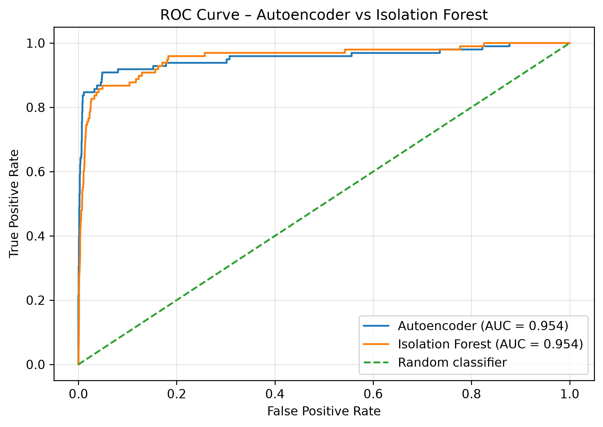
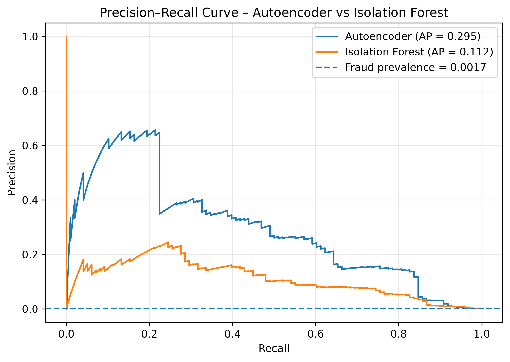
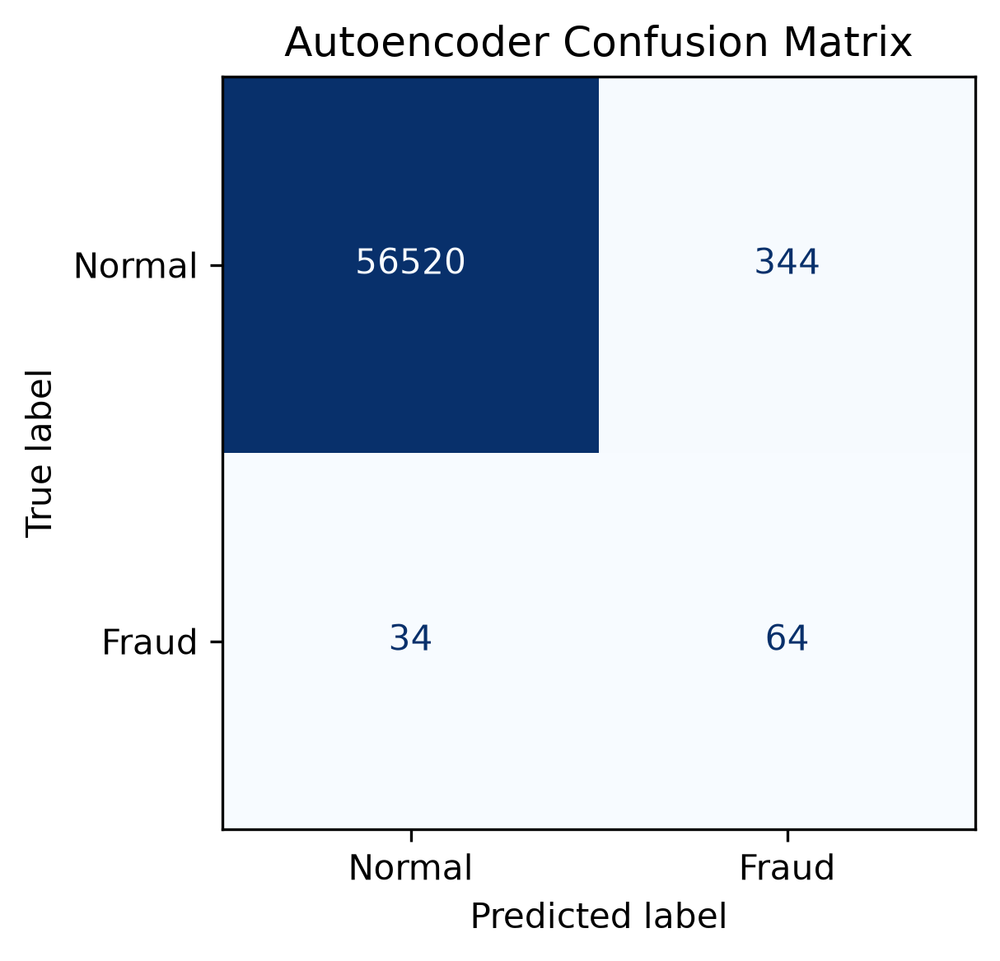
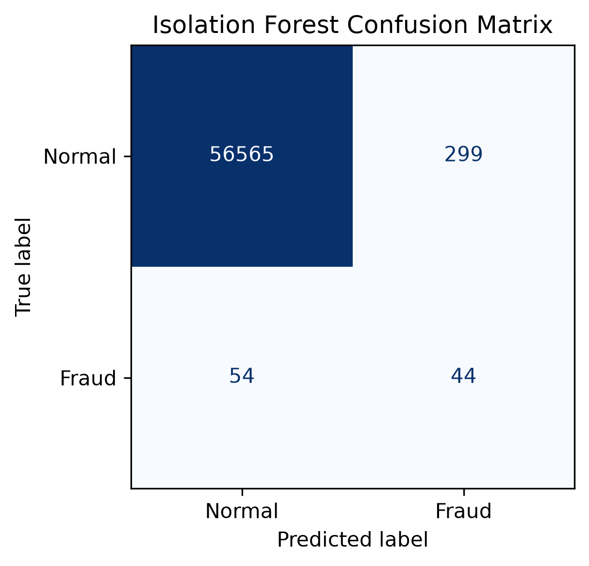

# Credit Card Anomaly Detection Using Apache Spark and Unsupervised Learning

An end-to-end academic prototype for detecting unusual credit-card transactions using **Isolation Forest** and a **Deep Autoencoder**, supported by Apache Spark data processing and a Streamlit interface.

## Project Overview

Fraudulent transactions are extremely rare compared with legitimate transactions. This makes anomaly detection challenging because a model can achieve high accuracy while missing many fraudulent transactions.

This project compares two unsupervised anomaly-detection techniques under severe class imbalance, using a held-out evaluation protocol.

## Technologies

- **Python** — core implementation
- **Apache Spark (PySpark)** — transaction-data processing and aggregation
- **Scikit-learn** — Isolation Forest, preprocessing, and evaluation
- **TensorFlow / Keras** — Autoencoder
- **Pandas and NumPy** — data manipulation
- **Matplotlib** — visualizations
- **Streamlit** — interactive prototype
- **Jupyter Notebook** — experimentation

## Dataset

Public credit-card fraud detection dataset:

| Property | Value |
|---|---:|
| Total transactions | 284,807 |
| Legitimate transactions | 284,315 |
| Fraudulent transactions | 492 |
| Fraud proportion | 0.173% |
| Input features | 30 |

The features include `Time`, `Amount`, and 28 anonymized PCA-transformed variables (`V1`–`V28`). The `Class` column is used as ground truth for evaluation, not as an input feature.

The dataset is excluded from Git because of its size.

Dataset: https://www.kaggle.com/datasets/mlg-ulb/creditcardfraud

## Methodology

### 1. Apache Spark Processing
Spark DataFrames are used to load, inspect, and aggregate transaction data. Spark provides the distributed-processing component of the workflow.

### 2. Isolation Forest
Isolation Forest identifies unusual observations using randomized partitions. The final experimental model uses a contamination setting of `0.005`.

### 3. Deep Autoencoder
The Autoencoder learns to reconstruct normal transaction patterns using the architecture:

`30 → 16 → 8 → 16 → 30`

Reconstruction mean squared error is used as the anomaly score. A threshold based on the 99.5th percentile of errors on a separate normal validation set converts scores into anomaly predictions.

### 4. Evaluation
The models are evaluated on the same held-out test set using accuracy, precision, recall, F1-score, false-positive rate, ROC-AUC, and Average Precision.

## Final Experimental Results

| Metric | Autoencoder | Isolation Forest |
|---|---:|---:|
| Accuracy | 0.993364 | 0.993803 |
| Precision | 0.156863 | 0.128280 |
| Recall | 0.653061 | 0.448980 |
| F1-score | 0.252964 | 0.199546 |
| False Positive Rate | 0.006050 | 0.005258 |
| ROC-AUC | 0.954081 | 0.954383 |
| Average Precision | 0.295108 | 0.112476 |

On the held-out test set containing 98 fraudulent transactions, the Autoencoder detected 64, while Isolation Forest detected 44.

**Key finding:** Both models achieved similar ROC-AUC, but the Autoencoder achieved substantially higher Average Precision. This highlights the importance of precision–recall evaluation for rare-event detection.

These are experimental results, not claims of real-world production performance.

## Visualizations

### ROC Curve Comparison


### Precision–Recall Curve


### Autoencoder Confusion Matrix


### Isolation Forest Confusion Matrix


## Repository Structure

```text
BigData-Fraud-Detection/
├── app.py
├── docs/
│   └── Learning_Notes.md
├── models/
│   ├── autoencoder.keras
│   ├── scaler.pkl
│   └── threshold.json
├── notebooks/
│   ├── 01_Data_Exploration.ipynb
│   ├── 02_Isolation_Forest.ipynb
│   ├── 03_Autoencoder.ipynb
│   ├── 04_Spark_Processing.ipynb
│   └── 05_Final_Model_Evaluation.ipynb
├── reports/
│   ├── figures/
│   └── publication_final_results.csv
└── README.md
```

## Streamlit Prototype

The Streamlit interface loads the saved Autoencoder, scaler, and anomaly threshold. It calculates reconstruction error for a selected transaction and displays whether the transaction is classified as normal or a potential anomaly.

To run locally, install the required Python dependencies and make the cleaned transaction dataset available at:

`data/processed/creditcard_clean.csv`

Then execute:

```bash
streamlit run app.py
```

A reproducible dependency file will be added separately.

**Note:** The saved Streamlit model artifacts were produced during prototype development and should not be confused with the separately evaluated final research models.

## Limitations

- The dataset is highly imbalanced and contains anonymized features.
- The evaluation uses historical transactions rather than live financial data.
- The experiment does not benchmark Spark scalability across cluster sizes.
- An anomaly prediction does not prove that a transaction is fraudulent.
- Model performance may change across datasets and operating thresholds.

## Research Context

**Research topic:** Anomaly Detection in Big Data Using Unsupervised Learning Techniques

**Project:** Scalable Anomaly Detection System Using Spark

The accompanying research study compares Isolation Forest and Autoencoder-based anomaly detection using leakage-aware evaluation and imbalance-sensitive metrics.

## Author

**Sanchita Senapati**  
B.Tech — Computer Science and Engineering (Cloud Computing)  
SRM Institute of Science and Technology

GitHub: https://github.com/sxnchita
